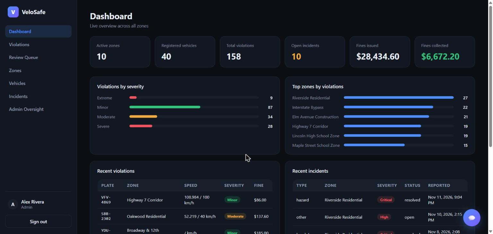

# VeloSafe — Traffic Enforcement System


A full-stack traffic safety monitoring platform: speed zones with posted limits, automatic
speed-violation detection (severity + fine calculated from how far over the limit a reading is),
a vehicle registry, incident logging (collisions, hazards, road closures), an admin dashboard
with live aggregate stats, and a built-in AI assistant chat widget that answers natural-language
questions about the live data.

The app ships pre-loaded with realistic seed data, so it's fully demo-able the moment it's running.



## What it does

- **Speed zones** — define road segments with posted limits (school, residential, highway, commercial)
- **Automatic violation detection** — submit a reading, get back severity and fine amount calculated from how far over the zone's limit it was
- **Vehicle registry** — track plates, make/model, owners
- **Incident logging** — collisions, hazards, and road closures with severity and status tracking
- **Evidence & audit trail** — attach evidence to violations, review queue, admin-only record management with a change log
- **Admin dashboard** — live aggregate stats, severity breakdowns, top zones by violation count
- **AI assistant chat widget** — ask it questions in plain English ("how many violations this week?", "what's the speed limit on Elm Avenue?") and it answers from the live database, no external API key required
- **Role-based access** — admin vs. operator accounts, JWT-authenticated

## Stack

- **Frontend**: React 18 + TypeScript + Vite + React Router, hand-rolled CSS (dark theme), no UI framework dependency
- **Backend**: Node.js + Express + TypeScript, SQLite via `better-sqlite3`
- **Auth**: JWT (12h expiry) + bcrypt password hashing
- **Validation**: zod schemas on every write endpoint
- **AI assistant**: a natural-language query engine that parses questions (time windows, zones,
  severities, statuses, plate lookups) and answers them from live SQL queries — no external API
  key required. See [Extending the assistant](#extending-the-assistant) to wire in a real LLM.

## Project structure

```
velosafe/
├── backend/          Express API (port 4000)
│   └── src/
│       ├── db/        SQLite connection, schema, seed script
│       ├── lib/        violation fine/severity calculator, chat engine
│       ├── middleware/ auth guard, error handling
│       ├── routes/     auth, zones, vehicles, violations, incidents, dashboard, chat
│       └── validators/ zod request schemas
├── frontend/         Vite SPA (port 5173, proxies /api to the backend)
│   └── src/
│       ├── api/        typed fetch client
│       ├── context/     auth context
│       ├── components/ layout, stat cards, chat widget
│       └── pages/       login, dashboard, zones, vehicles, violations, incidents
└── README.md
```

## Getting started

Requires Node.js 18+. (Note: `better-sqlite3` needs a prebuilt binary for your Node version —
if `npm install` tries to compile from source and fails, switch to a Node 18/20/22 LTS release.)

### 1. Backend

```bash
cd backend
cp .env.example .env
npm install
npm run seed   # creates the SQLite DB and fills it with demo data
npm run dev    # starts the API on http://localhost:4000
```

### 2. Frontend

In a second terminal:

```bash
cd frontend
npm install
npm run dev    # starts the SPA on http://localhost:5173
```

Open http://localhost:5173 and sign in with one of the seeded demo accounts:

| Username   | Password      | Role     |
|------------|---------------|----------|
| `admin`    | `admin123`    | admin    |
| `operator` | `operator123` | operator |

## Environment variables (backend/.env)

| Variable         | Default                        | Description                                  |
|------------------|---------------------------------|-----------------------------------------------|
| `PORT`           | `4000`                          | API server port                               |
| `JWT_SECRET`      | *(insecure dev default)*        | Secret used to sign JWTs — **change in prod** |
| `JWT_EXPIRES_IN`  | `12h`                           | Token lifetime                                |
| `DATABASE_PATH`   | `./data/velosafe.db`            | SQLite file location                          |
| `CORS_ORIGIN`     | `http://localhost:5173`         | Allowed frontend origin                       |

## API reference

All routes except `/api/health` and `/api/auth/login` require `Authorization: Bearer <token>`.

| Method | Path                          | Description                                  |
|--------|-------------------------------|-----------------------------------------------|
| GET    | `/api/health`                 | Health check                                  |
| POST   | `/api/auth/login`             | `{ username, password }` → `{ token, user }`  |
| GET    | `/api/auth/me`                | Current user                                  |
| GET    | `/api/zones`                  | List zones                                    |
| POST   | `/api/zones`                  | Create zone                                   |
| PATCH  | `/api/zones/:id`              | Update zone                                   |
| DELETE | `/api/zones/:id`              | Delete zone                                   |
| GET    | `/api/vehicles`                | List vehicles (`?search=`)                    |
| GET    | `/api/vehicles/:id`            | Vehicle detail + its violations               |
| POST   | `/api/vehicles`                | Register a vehicle                            |
| PATCH  | `/api/vehicles/:id`            | Update vehicle                                |
| DELETE | `/api/vehicles/:id`            | Delete vehicle                                |
| GET    | `/api/violations`              | List violations (`?severity=&status=&zone_id=&vehicle_id=`) |
| POST   | `/api/violations`              | Log a violation — severity & fine auto-calculated from posted zone limit |
| PATCH  | `/api/violations/:id/status`   | Update violation status                       |
| GET    | `/api/incidents`               | List incidents (`?status=&severity=`)         |
| POST   | `/api/incidents`               | Report an incident                            |
| PATCH  | `/api/incidents/:id`           | Update an incident                            |
| GET    | `/api/dashboard/summary`       | Aggregate stats for the dashboard             |
| POST   | `/api/chat`                    | `{ message }` → AI assistant reply from live data |

### Violation severity/fine bands

| Over limit    | Severity  |
|---------------|-----------|
| 0–10 km/h     | minor     |
| 10–20 km/h    | moderate  |
| 20–40 km/h    | severe    |
| 40+ km/h      | extreme   |

Fine amounts scale within each band — see `backend/src/lib/violationCalc.ts`.

## Extending the assistant

`backend/src/lib/chatEngine.ts` currently answers with a rule-based natural-language query
engine — it recognizes intents (violation counts, incident counts, fines, top zone, plate
lookup, zone speed limits), extracts time windows/zones/severities from the message, and
answers from live SQL queries. To swap in a real LLM (e.g. Claude) for freer-form questions:
add an API key to `.env`, install the relevant SDK, and replace the body of `answerQuestion`
with a call that gives the model tool access to the same query functions already defined in
that file — the intent-specific SQL helpers can be reused as tools.

## Verified working

- `npm run typecheck` passes clean on both `backend` and `frontend`
- `npm run build` (frontend) produces a clean production bundle
- Smoke-tested end-to-end in a headless browser: login, dashboard aggregation, zone/vehicle/violation/incident
  CRUD, violation auto-calculation, the AI chat widget, and the 401 auth guard on unauthenticated requests

## Production notes

This is a demo-ready prototype. Before deploying for real enforcement use, at minimum: rotate
`JWT_SECRET`, put the SQLite file on persistent storage (or migrate to Postgres for multi-instance
deployments), add rate limiting on `/api/auth/login`, and add HTTPS termination in front of the
API.

## License

MIT — see [LICENSE](LICENSE).
